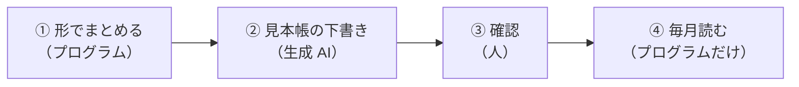

# 文字が取れない PDF を「字の見本帳」で読む — かんたんな説明

*A plain-language explainer in Japanese for non-engineers. Technical details: [README](README.md) and [`results/`](results/).*

このページは、プログラムを書かない人向けの説明です。
数字はすべて、このリポジトリで実際に測ったものです（自作のサンプルと、総務省統計局「人口推計」月報）。

---

## 1. どんな困りごと？

PDF の中には、**見た目は文字なのに、コピーしても文字が取れない**ものがあります。

- 文字が「文字」としてではなく、**絵（図形）として描かれている**
- 文字の情報は入っているが、**どの字かを示す情報が抜けていて**、コピーすると記号の羅列になる

こうした PDF は、検索も、表計算ソフトへの貼り付けも、読み上げソフトでの読み上げもできません。
毎月出る統計資料がこの形だと、毎月だれかが数字を手で打ち直すことになります。

## 2. 一言でいうと

> **一度だけ「字の見本帳」を作れば、あとは何度でもタダで、毎回同じに読める。**

絵として描かれていても、**同じ字はいつも同じ形**で描かれます。
そこで「この形は『5』」「この形は『人』」という見本帳を一度作れば、
あとは形を見本帳と照らし合わせるだけで、文字に戻せます。

たとえるなら、**手書きの癖が決まっている人の字を、一度だけ解読表にしておく**ようなものです。
表さえあれば、次の手紙からは表を引くだけで読めます。

## 3. 流れと、だれが何をするか

| 段階 | だれが | 何をする | 何回 |
| --- | --- | --- | --- |
| ① 形でまとめる | プログラム | 同じ形の字をひとまとめにする。月報 1 か月分（約 1.5 万字）でも、まとまりは約 1,000 個 | 最初の 1 回 |
| ② 下書き | 生成 AI | まとまりの見本を並べて見せ、「これは何の字か」を答えさせる | 最初の 1 回 |
| ③ 確認 | 人 | 4 つの生成 AI に下書きさせ、**答えが割れた所だけ**を見る（月報では約 1 割、113 個） | 最初の 1 回 |
| ④ 毎月読む | プログラムだけ | 見本帳と照らし合わせる。生成 AI は使わない | 毎回 |

むかしは②を人が全部やる必要があり、それが一番の壁でした。
生成 AI に下書きをさせることで、人の仕事は「割れた所の確認」だけになります。

## 4. 何がうれしいか（測った結果）

**毎回の費用がかからない。**
生成 AI に毎回読ませると、上位のモデルで 1 ページ約 0.07〜0.22 ドルかかりました。
月 1 万ページなら月 690〜2,150 ドルです。見本帳の方式は、費用がかかるのは最初の 1 回だけです。

**毎回同じ結果になる。**
生成 AI は、同じページでも読ませるたびに答えが変わることがありました。見本帳の方式は毎回同じです。

**資料を外に出さない。**
④は手元のパソコンだけで動きます。資料をインターネットの向こうに送りません。

**黙って間違えない。**
見本帳に無い形や、紛らわしい形は「?」として残し、**それらしい字をでっち上げません**。
実在の月報 15 万字でも、自作サンプル 17 条件中 16 条件でも、**黙った誤りは 0** でした。

| 読み方 | 実在の月報（11 か月分、15 万字）の黙った誤り | 1 ページの費用 |
| --- | --- | --- |
| 見本帳の方式 | **0**（読めない字は「?」） | 0 円 |
| 上位の生成 AI（Opus 5.5・Fable 5.2。Fable は 1・2 ページだけ測定） | **0** | 約 0.07〜0.22 ドル |
| 中位の生成 AI（Sonnet 5.5） | 7 | 約 0.03 ドル |
| ふつうの文字認識ソフト（OCR） | **4,145** | 0 円 |

### 正直に言うべきこと

**ふつうの資料なら、上位の生成 AI も正確に読めます**（実在の月報で誤り 0）。
見本帳の方式が「精度」で勝つのは、**紛らわしい字が多い資料**です。
たとえば大文字の I と小文字の l がほぼ同じ形のフォントや、カタカナの「カ」と漢字の「力」が混ざった品番などです。
そうした自作サンプルでは、生成 AI は迷わずどちらかに決めて間違えました（日本語で 192〜249 字）。

つまり、見本帳の方式の強みは **費用・毎回同じ・資料を出さない・黙って間違えない** の 4 つで、
精度そのものは「ふつうの資料なら上位の生成 AI と同じ、紛らわしい資料なら上」です。

## 5. 不安な点（隠さずに）

**見本帳が間違っていると、毎月同じように間違えます。**
一番成績のよい生成 AI の下書きでも、人が確認せずに使うと、11 か月で 200 字の誤りになりました。
**人の確認は省けません。** ただし全部を見る必要はなく、4 つの生成 AI の答えが割れた所（約 1 割）だけで、
全部を見たのと同じく誤り 0 になりました。
（4 つとも同じ答えで間違えた所が 1 か所ありました。今回はその字が後の月に出てこなかったので誤りになりませんでしたが、
「割れていない所も絶対に正しい」とは言えません。）

**書式が変わると「?」が増えます。**
月報の 11 月号で数字の大きさが変わったとき、その月の数字はほぼ全部「?」になりました
（1〜10 月号では「?」は約 3%）。黙って間違えはしませんが、新しい形を人が一度確認する必要があります。

**形が大きく揺れる PDF は苦手です。**
字の位置をわざと大きく揺らした試験では、誤りが出ました（25 字）。
ただしそのときは、見本帳を作る段階で「この資料は危ない」と分かる兆候が出ました。

**ページの向きと傾きは自動で直します。**
ページを上下逆にすると、「6」と「9」、「n」と「u」、「（」と「）」のように、別の字とまったく同じ形になる字があります。
最初の試作では、上下逆のページを読むと黙って読み違えました（英語 171 字、日本語 61 字）。
そこで、読む前にページの傾きを測ってまっすぐに戻し、4 通りの向き（0°・90°・180°・270°）のうち見本帳と一番よく合う向きに直すようにしました。
- 横向き・上下逆のページと、10° 以下の傾き（試したのは 0.3°・-4°・9° など）は、黙った誤りなく読めました。字の形がきれいな資料では回さない時とまったく同じ結果で、実在の月報では「?」がわずかに増えました（+0.4%）。
- 10° を超えて傾いたページは読まずに人に回します。
- 「?」が 3 割を超えたページも、丸ごと人に回します。

この 3 つは、測る前に合格の条件を決めて記録し、まだ試していない条件で確かめました（1 回目・2 回目で見つかった問題を直した 3 回目で、すべて合格）。

**まだ数回しか見ていない字には、印を付けます。**
形の近い別の字がある場合は「目で確かめてください」と知らせます。

**まだ測っていないこと。**
人が実際に 113 個を確認するのにかかる時間と、人の見間違い。縦書きは自作サンプル 1 種類だけで確かめました（横書きと同じく誤り 0）。
今回試した以外の文字認識ソフトや生成 AI。

## 6. 向いている資料・向いていない資料

| 向いている | 向いていない |
| --- | --- |
| 毎月・毎年、**同じ書式で出る**資料（統計の月報、定型の帳票） | 1 回きりの資料（見本帳を作る手間が割に合わない。生成 AI に 1 回読ませる方が早い） |
| ページ数が多く、**毎回の費用を抑えたい** | スキャンした紙（同じ字でも形が毎回少しずつ違う。別の方法が必要） |
| 資料を**外部に送れない** | 書式が毎回大きく変わる資料 |
| 紛らわしい字（I/l、0/O、カ/力）が多い | |

## 7. よくある質問

**Q. 生成 AI があれば十分では？**
ふつうの資料を少し読むだけなら十分です。違いが出るのは、同じ書式の資料を**何度も・大量に**読むときです。
毎回の費用、結果の揺れ、資料を外に出すことが気になる場合に、この方式が役に立ちます。

**Q. 見本帳はだれが作るの？**
下書きは生成 AI が作り、人は「答えが割れた所」だけを確認します。月報の場合、約 1,000 個のうち 113 個でした。

**Q. 読めない字はどうなるの？**
「?」として残ります。それらしい字に勝手に置き換えることはしません。人が「?」の字を見本帳に足せば、次からは読めます。

**Q. 使ったデータは？**
自作のサンプル（自分で作った架空の帳簿）と、総務省統計局「人口推計」月報（公共データ利用規約 第 1.0 版、CC BY 4.0 互換）です。
それ以外の資料は使っていません。月報の PDF そのものはこのリポジトリに置いていません。

---

出典：「人口推計」（総務省統計局）https://www.stat.go.jp/data/jinsui/new.html を加工して作成。
詳しい評価：[自作サンプル](results/evaluation-2026-11.md) ・ [実在の月報](results/public-evaluation-2026-11.md) ・ [関連 OSS](results/oss-evaluation-2026-11.md)
